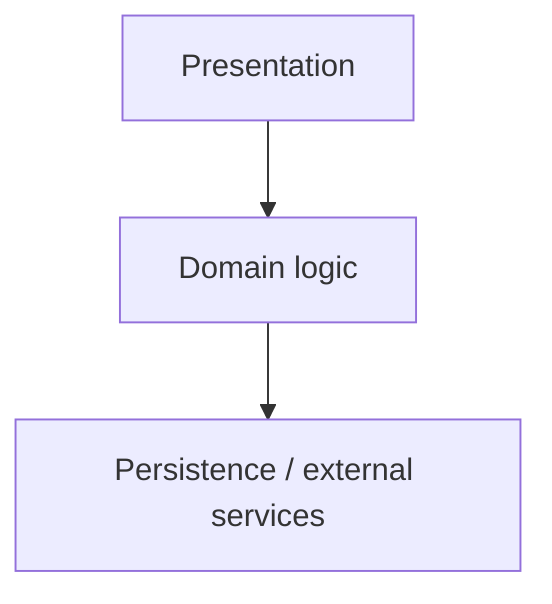

<!-- TEMPLATE: describe the real project once code exists. Remove sections
that do not apply instead of filling them with guesses, and delete this comment. -->

# Architecture

How PROJECT_NAME is put together and how data flows through it. The README
gives the short version; this document explains what a maintainer needs to
change the code safely. Decisions behind the structure are recorded in
[`DECISIONS/`](DECISIONS/README.md).

## In one paragraph

What kind of system this is (app, library, service, CLI), its main runtime and
framework, where state lives, and the path from input to output.

## Layers and boundaries

Name each major module, what it owns, and which modules it may depend on. A
small diagram helps when there are more than three parts:

## Data flow

Walk through one typical request, command or user action end to end, naming
the files and functions involved.

## Invariants and conventions

Rules the code relies on that are not obvious from a single file (for example
determinism, ownership of state, error-handling strategy).

## Testing

Where each kind of test lives, what it covers and how to run it.

## Extending

The usual change paths (add a feature, a data entry, an endpoint) and the
files each one touches.
